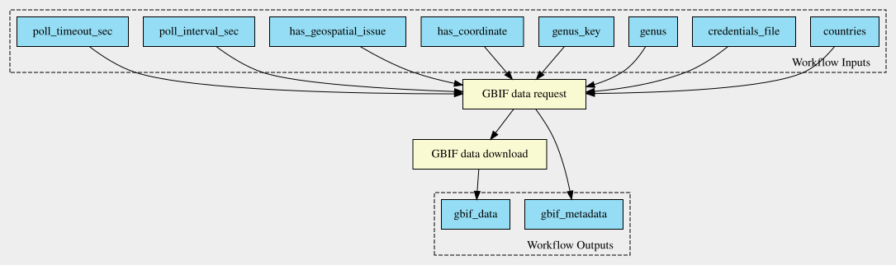

# GBIF Retrieval

Retrieves species occurrence records from GBIF as a citable snapshot. It can take either a GBIF download DOI, to fetch an existing snapshot again, or a query (taxon, countries, quality filters) that it submits to the GBIF Download API, which mints a new DOI. The output is the occurrence table in GBIF's SIMPLE_CSV format plus a metadata file with the DOI, licence and citation.

## Description

This workflow chains two steps to: 

1. submit a GBIF download request and 
2. download the GBIF data based on the metadata provided by the request.

Parameters:
* credentials_file: a file with GBIF credentials, see [Preparation: GBIF credentials](#preparation-gbif-credentials)
* genus: Genus name recorded in metadata, e.g. "Bombus"
* genus_key: GBIF taxon key for the genus, e.g. 1340278
* countries: Country codes to include, e.g. "PT,ES"
* output_meta: File name for output metadata file (default: "results/metadata.json")
* has_coordinate: Require coordinates (default: true).
* has_geospatial_issue: Include records with geospatial issues (default: false).
* poll_interval_sec: Seconds between status checks (default: 30).
* poll_timeout_sec: Maximum wait in seconds (default: 3600).

## Preparation: GBIF credentials

Create a `gbif_credentials.json` from the template `gbif_credentials.example.json` (git-ignored; never commit it). 
The credentials file "gbif_credentials.json" should contain GBIF credentials like this
```json
{"user": "your_gbif_username", "password": "your_password", "email": "your.email@example.com"}
```

It is added to gitignore to prevent sharing credentials. 

## Test 1: Use refactored script with CLI arguments

```bash
python 00-submit-request.py \
  --credentials-file gbif_credentials.json \
  --genus Bombus \
  --genus-key 1340278 \
  --countries ES PT \
  --has-coordinate \
  --no-has-geospatial-issue \
  --output_meta metadata.json \
  --poll-interval-sec 30 \
  --poll-timeout-sec 3600

python 01-download.py metadata.json
```

## Test 2: Use refactored script with CLI arguments + Dockerfile

### build image from dockerfile

```bash
docker build -t gbif_retrieval .
docker run --rm gbif_retrieval python --version
```

### run as before, but with docker

```bash
touch metadata.json
chmod 777 metadata.json # allows docker to write to the file
docker run --rm \
  -v "$(pwd):/app" \
  -w /app \
  gbif_retrieval \
  python 00-submit-request.py \
    --credentials-file gbif_credentials.json \
    --genus Bombus \
    --genus-key 1340278 \
    --countries ES PT
```

## Test the two steps CWL

```bash
cwltool --outdir results 00-submit-request.cwl test-00-submit-request.yml
```

```bash
cwltool --outdir results 01-download.cwl test-01-download.yml
```

## Execute the workflow

The [workflow.cwl](workflow.cwl) is executed as a [run.cwl](../../runs/GBIF_Retrieval/run.cwl) in `../../runs/GBIF_Retrieval/run.cwl` with job data provided by [run.yml](../../runs/GBIF_Retrieval/run.yml).


## Print workflow to img

```bash
cwltool --print-dot workflow.cwl | dot -Tsvg > workflow.svg
```


